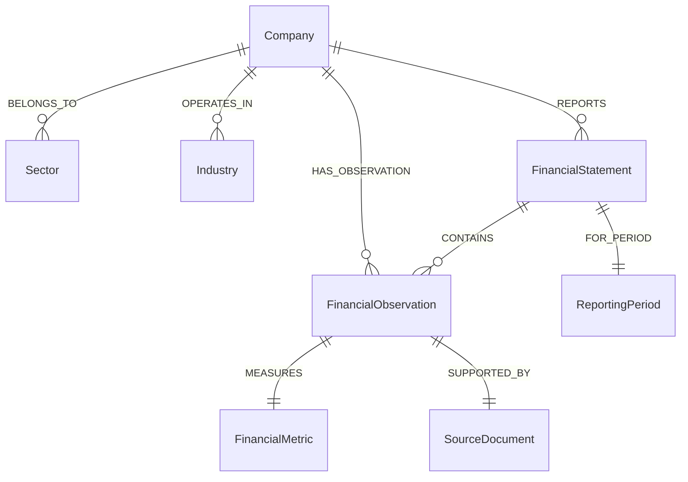

# 📈 FinGraph AI — Graph-Powered Financial Intelligence

> **Hackathon Submission:** FalkorDB Hackathon 2026  
> **Primary Track:** *Agents That Act on Connected Data*  
> **Secondary Track:** *Agent Memory and Coordination*  
> **FalkorDB Integration:** Primary Graph Database (Connected Financial Knowledge Graph & Multi-Hop Reasoning)  
> **Run locally:** Streamlit with FalkorDB, directly or through Docker Compose

---

## 1. Executive Summary

**FinGraph AI** is an enterprise-grade financial intelligence application where **FalkorDB is the primary, essential graph database engine**.

In traditional financial tools, metrics are siloed in isolated tables or ungrounded vector databases, leading to LLM hallucinations when answering cross-company or sector-wide questions. **FinGraph AI solves this by modeling financial reality as a connected knowledge graph in FalkorDB**:
- **Companies** operate in **Industries** and belong to **Sectors**.
- **Financial Observations** (Revenue, Net Income, Operating Margins, Free Cash Flow) belong to audited **Reporting Periods** and are supported by official **Source Documents** (SEC 10-K filings, BSE India annual reports).
- A multi-agent **LangGraph team** actively executes parameterized Cypher queries to perform multi-hop traversals, calculate comparative performance, and trace verifiable provenance.

Removing FalkorDB renders the core financial intelligence features completely inoperable, proving a hard architectural dependency.

---

## 2. Technology Stack

* **Graph Database:** [FalkorDB](https://www.falkordb.com/) (Graph Database with Cypher query language, node range indexing, and vector indices)
* **AI & Agent Orchestration:** LangGraph, LangChain Core, Groq LLM API (`openai/gpt-oss-120b`)
* **Key Reliability:** 3-Slot Configurable Key Manager with automatic sequential failover (`AI_API_KEY_1` ➔ `AI_API_KEY_2` ➔ `AI_API_KEY_3`)
* **Frontend UI:** Streamlit (Custom responsive theme, zero-sidebar top navigation, TradingView-style Altair interactive crosshair charting)
* **Market Data:** Public Yahoo Finance API (real-time & historical price inspection, no paid scrapers)
* **Containerization:** Docker and Docker Compose for the app and FalkorDB

---

## 3. System Architecture

```text
Browser (localhost:8501)
  -> Streamlit dashboard and AI chat
     -> Yahoo Finance market data
     -> LangGraph agents and Groq inference
     -> FalkorDB (localhost:6379, or the Compose service)
        -> Financial knowledge, conversation memory, service diagnostics
```

The application runs as a single Streamlit service. The local Docker Compose
configuration starts this service and FalkorDB with a persistent database volume.

---

## 4. FalkorDB Financial Knowledge Graph Schema

The primary knowledge graph (`financial_knowledge`) models financial reality using strict semantic relationships:



### Graph Entities
* **`:Company`**: `id`, `name`, `ticker`, `exchange`, `country`
* **`:Sector`**: `id`, `name` (e.g., Technology, Consumer Cyclical, Energy)
* **`:Industry`**: `id`, `name` (e.g., Consumer Electronics, Semiconductors)
* **`:FinancialMetric`**: `id`, `name`, `unit`, `description` (e.g., Total Revenue, Net Income, Operating Margin)
* **`:FinancialObservation`**: `id`, `value`, `currency`, `period_type` (`annual`/`quarterly`), `fiscal_year`, `period_start`, `period_end`, `filing_date`, `source_id`
* **`:ReportingPeriod`**: `id`, `fiscal_year`, `fiscal_quarter`, `period_start`, `period_end`
* **`:FinancialStatement`**: `id`, `type` (`income_statement`, `balance_sheet`, `cash_flow`), `period_id`
* **`:SourceDocument`**: `id`, `title`, `source_url`, `publication_date`, `license` (Official SEC Form 10-K or BSE India filings)

---

## 5. Why FalkorDB is Essential

FinGraph AI **cannot function normally without FalkorDB**. FalkorDB is not a cache or an optional analytics layer; it is the **primary computational foundation** for:

1. **Sector Peer Traversal:** Discovering competitors without hardcoded lists:
   `(:Company {ticker: $ticker})-[:BELONGS_TO]->(:Sector)<-[:BELONGS_TO]-(peer:Company)`
2. **Cross-Company Alignment:** Comparing multi-year historical growth across companies matching fiscal periods and currencies.
3. **Evidence Provenance:** Tracing any claim from observation back to its verified public SEC/BSE document:
   `(:Company)-[:HAS_OBSERVATION]->(:FinancialObservation)-[:SUPPORTED_BY]->(:SourceDocument)`
4. **Hard Dependency Verification:** When FalkorDB is stopped or disconnected, graph-powered financial questions explicitly fail with `FalkorDBUnavailableError`. The system refuses to fabricate data or fall back to ungrounded heuristics.

---

## 6. Representative Cypher Queries

### Query 1: Cross-Company Comparison (AAPL vs MSFT Revenue)
```cypher
MATCH (c:Company)-[:HAS_OBSERVATION]->(o:FinancialObservation)-[:MEASURES]->(m:FinancialMetric)
WHERE c.ticker IN $tickers
  AND (toLower(m.name) = toLower($metric) OR toLower(m.id) = toLower($metric))
  AND o.period_type = 'annual'
  AND ($fiscal_year IS NULL OR o.fiscal_year = $fiscal_year)
OPTIONAL MATCH (o)-[:SUPPORTED_BY]->(doc:SourceDocument)
RETURN c.ticker, c.name, m.name, o.fiscal_year, o.value, o.currency, doc.title, doc.source_url
ORDER BY o.fiscal_year DESC, o.value DESC
```

### Query 2: Sector Peer Discovery & Operating Margin Ranking
```cypher
MATCH (target:Company {ticker: $ticker})-[:BELONGS_TO]->(s:Sector)<-[:BELONGS_TO]-(c:Company)
MATCH (c)-[:HAS_OBSERVATION]->(o:FinancialObservation)-[:MEASURES]->(m:FinancialMetric)
WHERE toLower(m.name) = toLower($metric)
  AND o.period_type = 'annual'
  AND ($fiscal_year IS NULL OR o.fiscal_year = $fiscal_year)
RETURN c.ticker, c.name, s.name, o.fiscal_year, o.value, o.currency,
       CASE WHEN c.ticker = $ticker THEN true ELSE false END AS is_target
ORDER BY o.value DESC
```

*(See [docs/CYPHER_QUERIES.md](docs/CYPHER_QUERIES.md) for complete query catalog and execution plans).*

---

## 7. Permitted Public Data Sources

In strict adherence to Hackathon Rule 6, FinGraph AI utilizes **only verified, permitted public data**:
* **US Public SEC Filings:** Audited Form 10-K filings for Apple (CIK 0000320193), Microsoft (CIK 0000789019), Alphabet (CIK 0001652044), Amazon (CIK 0001018724), and NVIDIA (CIK 0001045810). Source URLs point directly to `https://www.sec.gov/Archives/edgar/data/...`.
* **Indian Public Annual Reports:** Audited annual financial reports for Reliance Industries Limited (BSE: 500325 / NSE: RELIANCE) and Tata Consultancy Services (BSE: 532540 / NSE: TCS) with official BSE India filing records.
* **Public Market Data:** Public Yahoo Finance ticker summaries and historical prices for interactive charting.
* **No Restricted APIs:** No SEC EDGAR API scrapers or Financial Modeling Prep (FMP) dependencies exist in the codebase.

---

## 8. Local Setup & Quickstart

### Prerequisites
* Docker & Docker Compose
* Python 3.12 (for local development)
* At least one AI API key (Groq)

### Step 1: Clone and Configure Environment
```bash
git clone https://github.com/workparty360/FinGraphAI.git
cd FinGraphAI/Fin_Model_123
nano .env
```

Set your own values in `.env` (keep this file private):

```dotenv
AI_API_KEY_1=your_groq_api_key
FALKORDB_HOST=localhost
FALKORDB_PORT=6379
```

### Run directly with Python

With FalkorDB running at the host and port configured in `.env`:

```bash
python3 -m venv .venv
source .venv/bin/activate
pip install -r requirements.txt
bash run.sh
```

### Step 2: Launch via Docker Compose
```bash
docker compose up -d
```

### Step 3: Seed FalkorDB Graph
```bash
docker compose run --rm app python scripts/init_graph.py
docker compose run --rm app python scripts/seed_graph.py
docker compose run --rm app python scripts/verify_graph.py
```

### Step 4: Open Application
Navigate to `http://localhost:8501`.

---

## 9. Automated Test Suite

FinGraph AI maintains a comprehensive automated test suite verifying graph integrity, multi-agent tool calling, fault tolerance, and API failover:

```bash
PYTHONPATH=. .venv/bin/pytest tests/ -v
```

### Test Coverage Highlights:
* `tests/test_financial_graph.py` (16 tests): Schema verification, cross-company comparisons, sector peer discovery, evidence provenance tracing, hard FalkorDB disconnection testing (`FalkorDBUnavailableError`), reconnection recovery, and Cypher injection prevention.
* `tests/test_agent_tool_calling.py` (11 tests): Native tool binding, fallback recovery, zero SEC/FMP scrapers.
* `tests/test_service_graph_and_failover.py` (20 tests): 3-slot AI key sequential failover, FalkorDB service dependency monitoring, failure root-cause analysis.
* `tests/test_chat_threads_and_cleanup.py` (10 tests): Independent chat threads, persistent turns, zero cross-talk.
* `tests/test_dashboard_optimization.py` (13 tests): Interactive crosshairs, OHLC tooltips, pin-to-click, zero zoom buttons.
* `tests/test_stock_api.py` (10 tests): Historical prices, statement calculations.

---

## 10. AI Assistance Disclosure

In full compliance with Hackathon Rule 11, the development of FinGraph AI utilized **Google Antigravity** as an AI pair-programming assistant for code refactoring, test generation, and documentation drafting. All architectural decisions, graph data schemas, Cypher query constraints, and verification procedures were directed, reviewed, and validated by the author.

---

## 11. Human Contributions & Verification

* **System Design & Graph Modeling:** Designed the 8-node, 8-relationship financial knowledge graph connecting companies, observations, periods, and official source documents.
* **Hard Dependency Architecture:** Ensured that FalkorDB is strictly required for financial intelligence rather than an optional layer.
* **Local Containers:** Configured the application and FalkorDB with health checks and persistent database storage.
* **Testing & Quality Assurance:** Authored automated test scenarios validating failure states, multi-key failover, and graph provenance paths.

*(See [docs/SUBMISSION_CHECKLIST.md](docs/SUBMISSION_CHECKLIST.md) for full compliance verification).*

---

## 12. License

FinGraph AI is released under the [MIT License](LICENSE). Source filings cited in the knowledge graph are public records from the U.S. Securities and Exchange Commission (SEC) and the Bombay Stock Exchange (BSE India).
