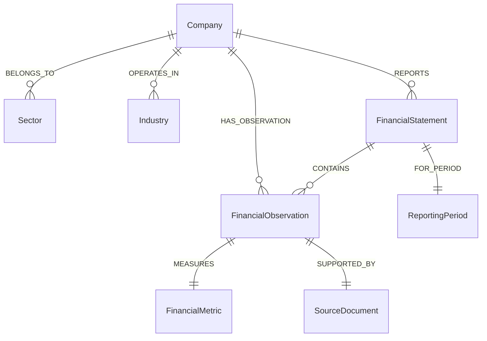

# 📊 FinGraph AI — Essential FalkorDB Cypher Queries Reference

This document provides a comprehensive, production-tested catalog of the Cypher queries driving **FinGraph AI**. Every query runs against FalkorDB, utilizes strict parameterization, and enforces graph traversal boundaries.

---

## 1. Graph Data Model & Relationship Topology



---

## 2. Core Cypher Queries Catalog

### Query 1: Find Company Profile, Sector & Industry
* **Purpose:** Resolves a ticker or company name to its fundamental graph node and identifies its industrial classification.
* **Input Parameters:** `{"ticker": "AAPL"}`
* **Cypher:**
  ```cypher
  MATCH (c:Company)
  WHERE c.ticker = $ticker OR c.id = $ticker
  OPTIONAL MATCH (c)-[:BELONGS_TO]->(s:Sector)
  OPTIONAL MATCH (c)-[:OPERATES_IN]->(i:Industry)
  RETURN c.id, c.name, c.ticker, c.exchange, c.country, s.name, i.name
  LIMIT 1
  ```
* **Relationships Used:** `[:BELONGS_TO]`, `[:OPERATES_IN]`
* **Why It Matters:** Serves as Step 1 in AI agent routing to establish context, currency, and sector classification before traversal.

---

### Query 2: Retrieve Historical Financial Observations by Metric
* **Purpose:** Fetches chronologically ordered financial metrics (Revenue, Net Income, Margins) for a single company.
* **Input Parameters:** `{"ticker": "AAPL", "metric": "Total Revenue", "period_type": "annual"}`
* **Cypher:**
  ```cypher
  MATCH (c:Company {ticker: $ticker})-[:HAS_OBSERVATION]->(o:FinancialObservation)-[:MEASURES]->(m:FinancialMetric)
  WHERE (toLower(m.name) = toLower($metric) OR toLower(m.id) = toLower($metric))
    AND ($period_type = 'all' OR o.period_type = $period_type)
  OPTIONAL MATCH (o)-[:SUPPORTED_BY]->(doc:SourceDocument)
  RETURN c.ticker, c.name, m.name, o.id, o.value, o.currency, o.fiscal_year, o.period_type,
         o.period_end, doc.id, doc.title, doc.source_url
  ORDER BY o.fiscal_year ASC
  LIMIT 10
  ```
* **Relationships Used:** `[:HAS_OBSERVATION]`, `[:MEASURES]`, `[:SUPPORTED_BY]`
* **Why It Matters:** Provides deterministic historical facts directly from verified filings without hallucination.

---

### Query 3: Cross-Company Financial Metric Comparison
* **Purpose:** Simultaneously queries and aligns financial metrics across multiple specified companies (e.g. AAPL vs MSFT).
* **Input Parameters:** `{"tickers": ["AAPL", "MSFT"], "metric": "Total Revenue", "fiscal_year": 2024}`
* **Cypher:**
  ```cypher
  MATCH (c:Company)-[:HAS_OBSERVATION]->(o:FinancialObservation)-[:MEASURES]->(m:FinancialMetric)
  WHERE c.ticker IN $tickers
    AND (toLower(m.name) = toLower($metric) OR toLower(m.id) = toLower($metric))
    AND o.period_type = 'annual'
    AND ($fiscal_year IS NULL OR o.fiscal_year = $fiscal_year)
  OPTIONAL MATCH (o)-[:SUPPORTED_BY]->(doc:SourceDocument)
  RETURN c.ticker, c.name, m.name, o.fiscal_year, o.value, o.currency, doc.title, doc.source_url
  ORDER BY o.fiscal_year DESC, o.value DESC
  ```
* **Relationships Used:** `[:HAS_OBSERVATION]`, `[:MEASURES]`, `[:SUPPORTED_BY]`
* **Why It Matters:** Implements Feature 1 (Cross-company comparison), calculating comparative growth rates across connected companies.

---

### Query 4: Discover Sector Peer Companies
* **Purpose:** Traverses sector relationships to identify all peer companies operating in the same sector.
* **Input Parameters:** `{"ticker": "AAPL"}`
* **Cypher:**
  ```cypher
  MATCH (target:Company {ticker: $ticker})-[:BELONGS_TO]->(s:Sector)<-[:BELONGS_TO]-(peer:Company)
  WHERE peer.ticker <> $ticker
  RETURN peer.ticker, peer.name, peer.exchange, peer.country, s.name
  ORDER BY peer.name ASC
  ```
* **Relationships Used:** `(c:Company)-[:BELONGS_TO]->(s:Sector)<-[:BELONGS_TO]-(peer:Company)`
* **Why It Matters:** Essential for sector-level intelligence. The system automatically finds that NVDA, MSFT, and TCS are peers of AAPL through shared graph topology.

---

### Query 5: Compare Metrics Across Sector Peers
* **Purpose:** Compares a performance metric (e.g., Operating Margin) across a company and all its sector peers.
* **Input Parameters:** `{"ticker": "AAPL", "metric": "Operating Margin", "fiscal_year": 2024}`
* **Cypher:**
  ```cypher
  MATCH (target:Company {ticker: $ticker})-[:BELONGS_TO]->(s:Sector)<-[:BELONGS_TO]-(c:Company)
  MATCH (c)-[:HAS_OBSERVATION]->(o:FinancialObservation)-[:MEASURES]->(m:FinancialMetric)
  WHERE (toLower(m.name) = toLower($metric) OR toLower(m.id) = toLower($metric))
    AND o.period_type = 'annual'
    AND ($fiscal_year IS NULL OR o.fiscal_year = $fiscal_year)
  RETURN c.ticker, c.name, s.name, o.fiscal_year, o.value, o.currency,
         CASE WHEN c.ticker = $ticker THEN true ELSE false END AS is_target
  ORDER BY o.value DESC
  ```
* **Relationships Used:** `[:BELONGS_TO]`, `[:HAS_OBSERVATION]`, `[:MEASURES]`
* **Why It Matters:** Implements Feature 2 (Sector-based financial discovery), ranking companies within a sector by profitability.

---

### Query 6: Trace Observation-to-Source Evidence & Provenance Path
* **Purpose:** Traverses the complete provenance graph from an observation to its underlying SEC/BSE source document.
* **Input Parameters:** `{"obs_id": "obs_AAPL_revenue_2024_annual"}`
* **Cypher:**
  ```cypher
  MATCH (c:Company)-[:HAS_OBSERVATION]->(o:FinancialObservation {id: $obs_id})-[:MEASURES]->(m:FinancialMetric)
  OPTIONAL MATCH (o)-[:SUPPORTED_BY]->(doc:SourceDocument)
  OPTIONAL MATCH (stmt:FinancialStatement)-[:CONTAINS]->(o)-[:FOR_PERIOD]->(p:ReportingPeriod)
  RETURN c.ticker, c.name, m.name, m.unit, o.id, o.value, o.currency, o.fiscal_year,
         o.period_type, o.period_end, o.filing_date, stmt.type, p.id,
         doc.id, doc.title, doc.source_url, doc.publication_date
  LIMIT 1
  ```
* **Relationships Used:** `[:HAS_OBSERVATION]`, `[:MEASURES]`, `[:SUPPORTED_BY]`, `[:CONTAINS]`, `[:FOR_PERIOD]`
* **Why It Matters:** Implements Feature 3 (Financial evidence tracing), answering "Where did this number come from?" with verifiable public filing links.

---

### Query 7: Retrieve Complete Metric Multi-Year History
* **Purpose:** Retrieves all historical metrics and annual observation values for a company to power trend analysis.
* **Input Parameters:** `{"ticker": "AAPL", "period_type": "annual"}`
* **Cypher:**
  ```cypher
  MATCH (c:Company {ticker: $ticker})-[:HAS_OBSERVATION]->(o:FinancialObservation)-[:MEASURES]->(m:FinancialMetric)
  WHERE ($period_type = 'all' OR o.period_type = $period_type)
  RETURN m.name, o.fiscal_year, o.value, o.currency, o.period_end
  ORDER BY m.name ASC, o.fiscal_year ASC
  ```
* **Relationships Used:** `[:HAS_OBSERVATION]`, `[:MEASURES]`
* **Why It Matters:** Enables the AI analyst agent to perform multi-year CAGR, trend, and profitability trajectory computations.

---

### Query 8: Graph Statistics & Verification
* **Purpose:** Computes live node label and relationship counts for health checks, debugging, and the UI graph explorer.
* **Cypher:**
  ```cypher
  MATCH (n:Company) RETURN count(n);
  MATCH (n:FinancialObservation) RETURN count(n);
  MATCH ()-[r:REL_MEASURES]->() RETURN count(r);
  MATCH ()-[r:REL_SUPPORTED_BY]->() RETURN count(r);
  ```
* **Why It Matters:** Verifies database integrity during startup and demonstrates real-time graph utilization.
